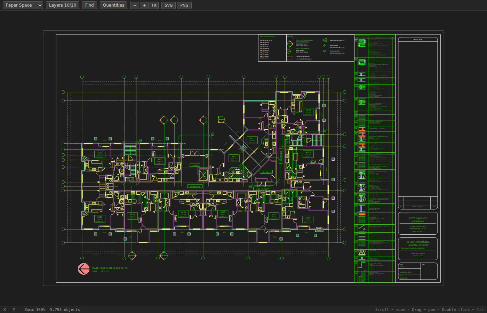
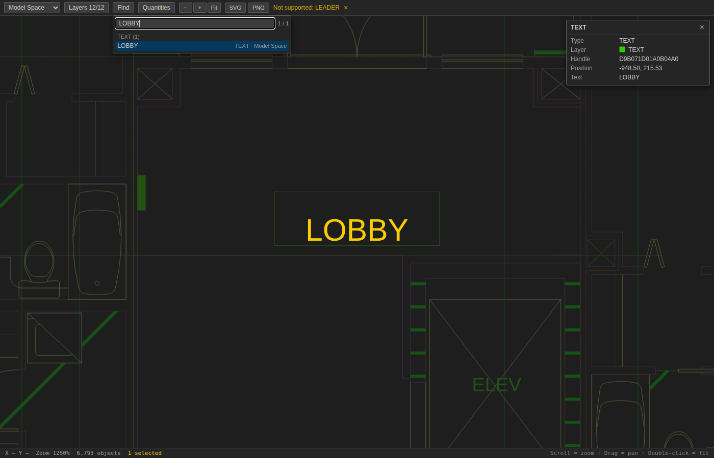
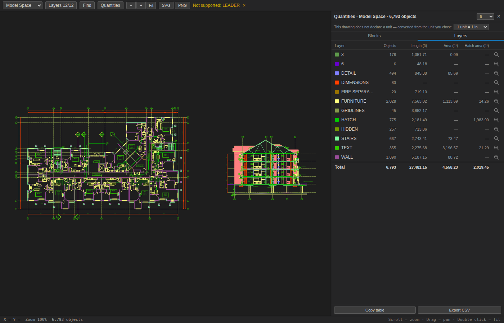
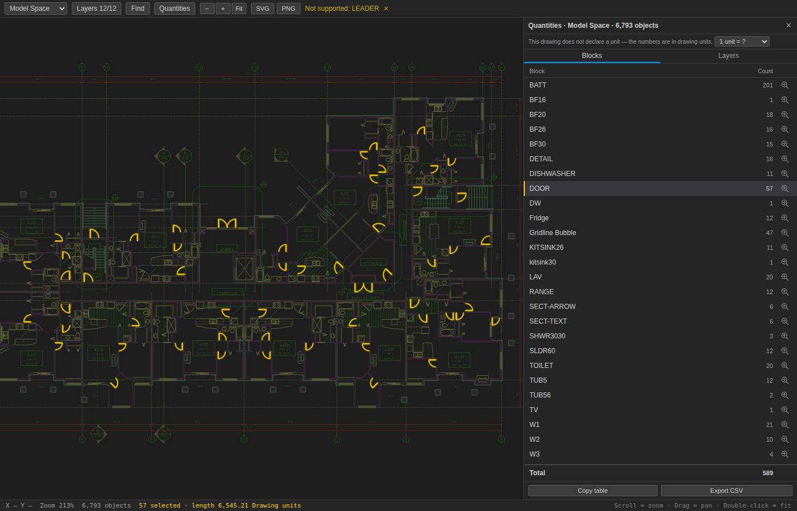

<p align="center">
  
</p>

<h1 align="center">AutoCAD DWG &amp; DXF Previewer for VS Code</h1>

<p align="center">
  <b>Open, view and inspect AutoCAD <code>.dwg</code> and <code>.dxf</code> drawings in VS Code — no AutoCAD, no license, no upload.</b><br>
  A free, open-source DWG viewer and DXF viewer with layers, search, quantity takeoff, Git diff and an MCP server for AI agents.
</p>

<p align="center">
  <a href="https://marketplace.visualstudio.com/items?itemName=bumkom.dwg-previewer"></a>
  <a href="LICENSE"></a>
  
  
  <a href="https://buymeacoffee.com/bumkom"></a>
</p>



## Why this DWG viewer

- **Open DWG files without AutoCAD.** A built-in WebAssembly build of [GNU LibreDWG](https://www.gnu.org/software/libredwg/) reads the drawing. Nothing to install, no account, no trial.
- **Your drawings stay on your machine.** No "free online DWG viewer" that wants a client's floor plan uploaded to a random server. Works fully offline.
- **Fast.** A 45,000-entity site plan opens in about two seconds; reopening is instant.
- **Made for people who review drawings,** not just glance at them: find text, count blocks, measure lengths and areas, compare two revisions.
- **Lets AI agents read the drawing.** Claude Code, GitHub Copilot and other MCP clients can answer "how many doors are on this plan?" from the drawing's data instead of guessing from a picture.

## Install

1. Install **[AutoCAD DWG & DXF Previewer](https://marketplace.visualstudio.com/items?itemName=bumkom.dwg-previewer)** from the VS Code Marketplace, or run
   `code --install-extension bumkom.dwg-previewer`.
2. Open any `.dwg` or `.dxf` file.

That is the whole setup.

## Features

### View DWG and DXF drawings

- **Instant preview** — double-click a `.dwg` or `.dxf` file and it opens as a drawing, not as binary
- **Pan and zoom** — scroll to zoom toward the cursor, drag to pan, double-click to fit
- **Layers** — show or hide any layer, with an object count for each; layers switched off in a DXF start hidden
- **Model Space and Paper Space** — switch between the model and every layout sheet, viewports included
- **Export to SVG or PNG** — drop the current view into a document, ticket or chat
- **Live reload** — the view refreshes when the file changes on disk and keeps your sheet, layers and zoom
- **Vietnamese TCVN3 fonts** (`.Vn*`) display correctly

### Find text, attributes and blocks



**Ctrl+F** searches text, block attributes (part numbers, door tags — hidden ones too), block names, layers and object types across every sheet. Click any object to inspect its layer, position, rotation, scale and attributes.

### Quantity takeoff: count blocks, measure length and area



**Quantities** counts every block (`Door-900` × 14) and measures linework, area and hatch area per layer, in the units the drawing declares or the one you pick. Shift-click objects to add up their length and area. Copy the table into a spreadsheet or export it as CSV.



Pick a row to select and zoom to those objects — here, all 57 doors of the plan.

### Compare two DWG revisions (visual diff)

**DWG: Compare with HEAD** (Git), **Compare with File…** or two selected files: added objects in green, removed in red, changed in yellow over their old shape, with a list of every change to step through with **F7**. Useful for reviewing CAD files in a pull request.

### Ask AI about your drawing (MCP server)

The extension runs a local [Model Context Protocol](https://modelcontextprotocol.io) server, so an AI agent can read the drawing you have open and answer from its real data.

| Tool | What the agent gets |
|------|---------------------|
| `dwg_overview` | Sheets, units, layers, block counts — the place to start |
| `dwg_find_text` | Text and attributes, accent-insensitive, with what they sit inside or near |
| `dwg_dimensions` | Dimension values together with the text written on them |
| `dwg_show` | Highlights and zooms to objects in your preview, so you see what it means |
| `dwg_snapshot` | A picture of the view or a region |

**Setup**

| Agent | How |
|-------|-----|
| Claude Code | Run **DWG: Connect AI Agents…** (or accept the prompt the first time you open a drawing; it only appears when Claude Code is installed). This runs `claude mcp add` for you and registers the server as `dwg-previewer`. |
| GitHub Copilot | Automatic on VS Code 1.101 or newer. The tools appear in Copilot Chat agent mode; the first use in a session may take a moment while the server starts. |
| Other agents | Run **DWG: Connect AI Agents…** and copy the URL and the `Authorization` header. Add them to the agent's MCP settings; the config format differs per agent, see its MCP documentation. |

**Which files an agent can read.** Drawings in your workspace folders and drawings open in a preview are free. Any other `.dwg` / `.dxf` needs your click on a modal **Allow** prompt first.

**Settings**

| Setting | Description | Default |
|---------|-------------|---------|
| `dwgPreviewer.ai.enabled` | Run the local server that lets AI agents read drawings. It starts the first time you open a drawing, connect an agent or Copilot asks for it. Off: the server stops and nothing new is cached; **DWG: Clear Drawing Cache** removes drawings cached earlier. | `true` |
| `dwgPreviewer.ai.port` | Local port of the server (127.0.0.1 only). If another program uses it, you are told once and AI features stay off until you pick another port. | `45131` |

**Limits.** It works only while VS Code is open — the server lives inside the extension.

**Privacy.** The extension itself sends nothing anywhere. When your agent calls a tool, the drawing text, numbers and snapshots it asks for go to the AI model you chose for that agent, and only then. Agents normally ask before calling a tool. The server listens on 127.0.0.1 and requires a token. Note: Connect passes that token to `claude mcp add` on its command line, so other local processes could see it while that command runs.

## Supported files

**DWG:** AutoCAD R14 through the AC1032 format (AC1014 – AC1032).
**DXF:** ASCII DXF opens directly, with no conversion step. Binary DXF is not supported and says so instead of opening blank.
The format is detected from the file header, so a DWG saved as `.dxf` still opens.

| Category | Entities |
|----------|----------|
| Geometry | LINE · CIRCLE · ARC · POLYLINE · LWPOLYLINE · SPLINE · ELLIPSE |
| Fills | SOLID · HATCH (solid + pattern approximation) |
| Text | TEXT · MTEXT · ATTRIB — with fonts, alignment and rotation |
| Blocks | INSERT (nested, rotated, mirrored, scaled, grid arrays) |
| Dimensions | DIMENSION — dimension and extension lines, arrowheads, text |
| Other | POINT · 3DFACE (flattened wireframe) · paper-space viewports |

This is a 2D viewer: 3D solids are not drawn. The toolbar names every entity type in a drawing that it cannot draw yet (LEADER, MULTILEADER, TABLE, WIPEOUT and 3D solids are the common ones).

## Keyboard and mouse

| Action | Effect |
|--------|--------|
| Scroll wheel | Zoom toward cursor |
| Mouse drag | Pan |
| Double-click | Fit drawing to view |
| Layer checkbox | Hide/show layer (preserves zoom) |
| Page dropdown | Switch between sheets |
| Ctrl+F, Enter / Shift+Enter | Find; next / previous result |
| Click an object | Select it and open the inspector (Esc to clear) |
| Shift+click | Add / remove an object from the selection (length and area in the status bar) |
| 🔍 on a quantities row | Select those objects and zoom to them |
| F7 / Shift+F7 (diff view) | Next / previous change |

## FAQ

**Do I need AutoCAD to open a DWG file?**
No. The DWG reader is built into the extension.

**Can I edit drawings?**
No — this is a viewer. Files are opened read-only and never modified.

**Are my files uploaded anywhere?**
Never. Everything runs locally inside VS Code, with no internet connection needed.

**A drawing does not open or looks incomplete?**
See [Troubleshooting](#troubleshooting). Very new or damaged files can be opened through an external converter.

## Configuration (optional)

The extension works without any configuration. For files that the bundled converter
cannot handle (very new DWG versions, corrupted files), you can install an external
converter as fallback:

| Setting | Description | Default |
|---------|-------------|---------|
| `dwgPreviewer.converterPath` | Path to an external converter executable (dwg2dxf or ODAFileConverter). Leave empty to use the bundled converter. | `""` |

**LibreDWG (open source):**
```bash
# Ubuntu/Debian
sudo apt install libredwg-utils

# Fedora/RHEL
sudo dnf install libredwg-utils

# macOS
brew install libredwg
```

**ODA File Converter (free for non-commercial use):**
Download from [Open Design Alliance](https://www.opendesign.com/guestfiles/oda_file_converter).

```json
{
  "dwgPreviewer.converterPath": "/usr/local/bin/dwg2dxf"
}
```

```json
{
  "dwgPreviewer.converterPath": "C:\\Program Files\\ODA\\ODAFileConverter\\ODAFileConverter.exe"
}
```

## Troubleshooting

**"Failed to convert DWG file"**
- The file may use a DWG version the bundled converter does not support
- Install an external converter as fallback (see Configuration above)
- Or set `dwgPreviewer.converterPath` to the full path of your converter executable

**Drawing looks incomplete**
- Some entity types may not be supported yet (check the toolbar banner)
- Objects hidden in the file itself — invisible attributes, hidden dynamic-block states — are left out on purpose, as in AutoCAD

**Large files are slow to open**
- The WASM converter processes the entire file in memory
- Very large drawings (>50MB) may take a few seconds

**Something else?** Open **View → Output**, select **DWG Previewer**, and attach that log (and the drawing, if you can share it) to an [issue](https://github.com/chieund/markdown-dwg-previewer/issues).

## How it works

```
┌─────────┐     ┌──────────────┐     ┌──────────┐     ┌──────────┐
│ .dwg    │────▶│ WASM         │────▶│ DXF      │────▶│ SVG      │
│ (binary)│     │ converter    │     │ parser   │     │ renderer │
└─────────┘     │ (built-in)   │     └──────────┘     └──────────┘
                └──────────────┘
```

1. **DWG → DXF conversion**: a bundled WebAssembly converter (LibreDWG) turns the binary DWG into DXF text, in a worker thread, with no external installation
2. **DXF parsing**: the DXF text is parsed into a drawing model (entities, layers, blocks, viewports)
3. **SVG rendering**: entities are drawn as SVG in a webview with pan/zoom

```
Extension Host (Node.js)          │  Webview (Browser)
──────────────────────────────    │  ──────────────────────
extension.ts (activation)         │  main.ts (toolbar, layers, pages)
dwgEditorProvider.ts (lifecycle)  │  renderer.ts (entity → SVG)
dwg/workerClient.ts ──► worker    │  panZoom.ts (scroll/drag/fit)
── worker thread (out/worker.js) ─│
dwg/converter.ts (DWG→DXF)       │
  ├─ WASM (libredwg-web)         │  export.ts (SVG/PNG output)
  └─ CLI fallback (dwg2dxf)      │
dxf/parseDxf.ts (main parser)    │  Communication:
dxf/hatch.ts (HATCH scanner)     │  Host → Webview: postMessage(DXF_DATA)
dxf/viewport.ts (VP scanner)     │  Webview → Host: postMessage(EXPORT)
ai/ (MCP server, tools)          │
```

The full architecture, the progress log and the design specs live in the
[dwg-previewer-docs](https://github.com/chieund/dwg-previewer-docs) repository.

## Development

```bash
npm install          # install dependencies
npm run build        # build
npm run watch        # watch mode
npm run typecheck    # type check
npm test             # unit tests
npm run package      # package as .vsix
```

To debug: open this project in VS Code, press **F5** to launch the Extension Development Host, and open any `.dwg` file in the new window.

## More extensions by bumkom

| | Extension | What it does | Highlights |
|---|---|---|---|
| 📐 CAD | **[DXF Previewer](https://marketplace.visualstudio.com/items?itemName=bumkom.dxf-previewer)** | Preview 2D DXF drawings in VS Code | Opens the drawing instead of raw text |
| 📝 Markdown | **[Markdown Viewer Premium](https://marketplace.visualstudio.com/items?itemName=bumkom.markdown-viewer-premium)** | Markdown preview and export to PDF, Word and HTML | Mermaid · PlantUML · Graphviz · KaTeX math · Jira & Backlog markup · Obsidian callouts and wiki links · offline |
| 📝 Markdown | **[Markdown Viewer Lite (Pele)](https://marketplace.visualstudio.com/items?itemName=bumkom.markdown-viewer-lite)** | Fast, lightweight Markdown preview | TOC · in-page search · syntax highlighting · Pele-powered Mermaid diagrams · HTML/PDF export |
| 🤖 AI coding | **[Bumeter — AI Coding Token Usage](https://marketplace.visualstudio.com/items?itemName=bumkom.bumeter)** | See where your Claude Code, Kiro and OpenCode tokens go | Quota and reset times · what consumed the quota · conversations ranked by tokens · skill costs · local only |
| 🤖 AI coding | **[Claude Code Usage](https://marketplace.visualstudio.com/items?itemName=bumkom.bumeter-claude-usage)** | Claude Code quota and context size in the status bar | 5-hour and weekly quota · reset countdown · alerts at 80 % / 90 % · usage analytics · local only |
| 🤖 AI coding | **[Claude Code Skills Manager](https://marketplace.visualstudio.com/items?itemName=bumkom.bumeter-claude-skills)** | Install, enable, disable and remove Claude Code skills | Install from skills.sh, git or a folder · token cost per skill · skills leaderboard · undo and trash recovery |

If this extension saved you an AutoCAD launch or a license, **[buy me a coffee ☕](https://buymeacoffee.com/bumkom)**.

## License

GPL-3.0-or-later — see [`LICENSE`](LICENSE).

The extension loads and calls the bundled LibreDWG converter (`@mlightcad/libredwg-web`,
GPL-3.0) in-process, so the extension as a whole is distributed under the GPL.
Third-party components and their licenses are listed in
[`THIRD_PARTY_NOTICES.md`](THIRD_PARTY_NOTICES.md).

*Not affiliated with, endorsed by, or sponsored by Autodesk. AutoCAD, DWG and DXF are
trademarks of Autodesk, Inc., used here only to describe the file formats this extension reads.*
